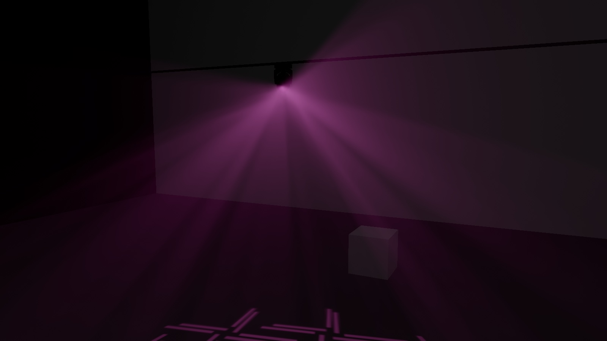
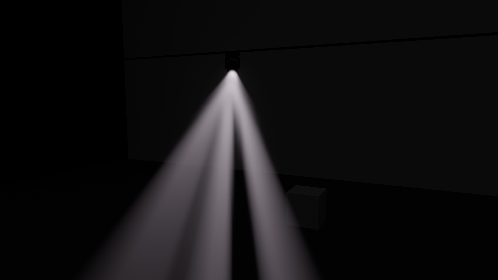
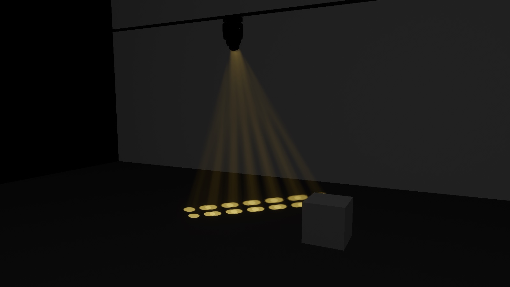
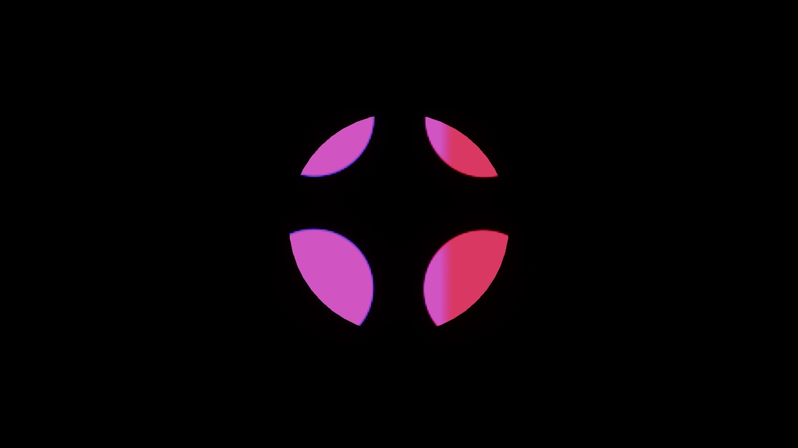
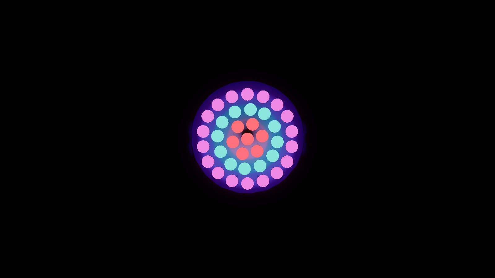
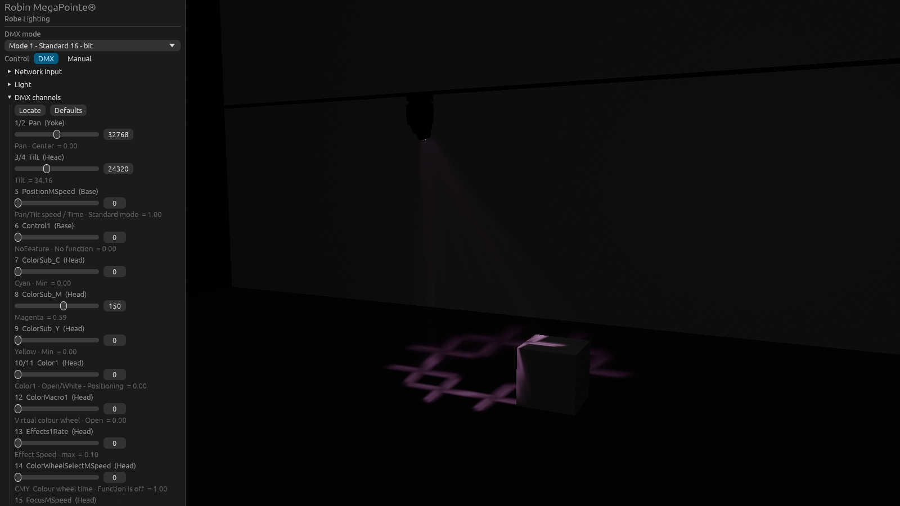
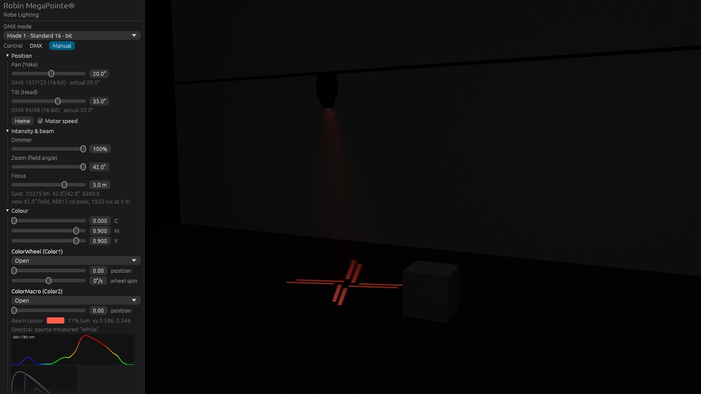

# GDTF Viewer

**A physically based, real-time renderer for stage lighting fixtures.** Open any `.gdtf`
file and see the fixture as it really behaves: moving heads that pan and tilt at motor
speed, gobos and prisms projected through haze, colour mixed from the manufacturer's
measured spectra — driven by on-screen faders, Art-Net or sACN.

Written in Rust on [wgpu](https://wgpu.rs) (Metal, Vulkan, DX12).



<table>
  <tr>
    <td></td>
    <td></td>
  </tr>
  <tr>
    <td align="center"><sub>Gobo shafts in haze — "3 Stripes" aimed at the camera</sub></td>
    <td align="center"><sub>6-facet linear prism × 4-dot gobo, amber CMY, 15° zoom</sub></td>
  </tr>
  <tr>
    <td></td>
    <td></td>
  </tr>
  <tr>
    <td align="center"><sub>Looking into the lens: the gobo and a half-and-half colour wheel</sub></td>
    <td align="center"><sub>37-pixel wash, each ring its own colour over DMX</sub></td>
  </tr>
</table>

---

## Highlights

**Reads the whole fixture from GDTF**
- Geometry tree, glTF models, pan/tilt axes, beams, multi-cell fixtures (`GeometryReference`)
- Every DMX mode: 8/16/24-bit channels, channel functions, **mode masters**, channel sets,
  wheel-slot positioning, virtual channels
- Colour, gobo and prism wheels (index, rotation, wheel spin, split positions), CMY, additive
  emitters, CTO/CTC, zoom, focus, frost, shutter and strobe

**Light, in physical units**
- Intensity from the file's luminous flux and beam/field angles; illuminance in lux, radiance in
  nits; camera exposure in EV100
- Beam shadows, gobo projection with **real defocus** (sharp at the focus distance, blurred
  elsewhere — computed from the lens aperture)
- **Volumetric beams** in haze: per-beam ray-marching with gobos, prisms, colour and shadows,
  temporal accumulation, depth-aware upsampling
- **Prisms** as the sum of their facet images, from the file's facet transforms
- The lens shows what the beam projects: the gobo and colour split, magnified, at up to
  ~2 million nits — with bloom
- AgX (or ACES) tonemapping, wide-gamut **Rec.2020** working space with gamut compression

**Colour from measured spectra**
- Emitter and filter spectra from `PhysicalDescriptions`, integrated with the CIE 1931
  observer. For the MegaPointe the computed CMY transmissions match the file's own values to
  about 0.1 percentage points (Cyan 20.88 % vs 20.98 %, Magenta 11.90 % vs 11.94 %, Yellow 76.69 %
  vs 76.58 %).
- Falls back to CIE xyY / colour temperature when a file has no spectra

**Live control**
- DMX fader panel showing the active function, channel set and physical value per channel
- **Art-Net** and **sACN** input (any universe, any start address)
- Manual mode with physical sliders (degrees, levels, slots)

**Fast**
- ~10 ms per frame at 2880×1720 on an Apple M1 for a beam with gobo in haze
- **Automatic quality** keeps 60 fps: it measures GPU time every frame and adjusts the
  volumetrics within a few frames, dropping several levels at once when needed

| DMX control | Light analysis |
|---|---|
|  |  |

---

## Getting started

You need [Rust](https://rustup.rs) (stable, 2024 edition) and a GPU with Metal, Vulkan or DX12.

```sh
git clone <this repository> gdtf-viewer
cd gdtf-viewer
cargo run --release -- path/to/fixture.gdtf
```

GDTF files are published by manufacturers on [GDTF Share](https://gdtf-share.com) (free
account). No fixture files are included in this repository.

### Controls

| Input | Action |
|---|---|
| Left drag | Orbit |
| Right / middle drag | Pan |
| Scroll | Zoom |
| <kbd>R</kbd> | Reset view |
| <kbd>Esc</kbd> | Quit |

The side panel switches between **DMX** (faders / network) and **Manual** control, and holds the
haze, exposure, tonemapping, quality and frame-statistics settings.

### DMX over the network

Open *Network input*, pick **Art-Net** (UDP 6454) or **sACN** (UDP 5568, multicast), set the
universe and the fixture's start address, and tick *Listen*. Or from the command line:

```sh
cargo run --release -- fixture.gdtf --artnet 0 --address 1
cargo run --release -- fixture.gdtf --sacn 1 --address 101
```

### Command line

Everything in the UI can also be set from the command line — useful for scripted renders.

| Option | Meaning |
|---|---|
| `--mode N` | DMX mode (index) |
| `--dmx ADDR=V,…` | DMX slot values, 1-based within the fixture |
| `--artnet U` / `--sacn U` / `--address A` | Network DMX input |
| `--pan DEG` `--tilt DEG` `--dimmer 0..1` | Position and level (manual control) |
| `--wheel ATTR=POS` `--index ATTR=DEG` | Wheel slot (0-based, fractional = in between) and gobo index, e.g. `--wheel Gobo2=3 --index Gobo2=20` |
| `--cmy C,M,Y` `--cto K` `--zoom DEG` `--focus-dist M` `--frost F` | Colour and beam |
| `--haze D` / `--no-haze` | Haze scattering coefficient (1/m) |
| `--ev EV100` `--house LUX` `--bloom S` `--tonemap agx\|aces` | Camera and display |
| `--quality N` | Fixed quality level 0–5 (default: automatic) |
| `--view YAW,PITCH,DIST` `--target X,Y,Z\|lens` `--off-axis DEG` | Camera; `--target lens --off-axis 2` looks into the beam |
| `--screenshot out.png [--no-ui] [--size WxH]` | Render one frame headless |
| `--bench N [--size WxH]` | Render N frames headless and print CPU/GPU timings |
| `--continuous` | Redraw every frame and log frame statistics |

For example, the hero image above:

```sh
cargo run --release -- Robe_Lighting@Robin_MegaPointe.gdtf --no-ui --size 1600x900 \
  --tilt -50 --pan 25 --wheel Gobo2=3 --index Gobo2=12 --wheel Prism1=3 \
  --cmy 0,0.85,0.2 --haze 0.06 --ev 6 --quality 5 --screenshot hero.png
```

---

## How it works

```
.gdtf ──▶ gdtf-loader ──▶ fixture ─────────────────────────────▶ renderer ──▶ screen
          zip, XML,        rig (geometry tree, pan/tilt)           shadow maps
          glTF meshes,     DMX patch → channel functions           forward pass (HDR, nits)
          wheel images     per-beam optics: colour, gobos,         volumetric haze ½ or ¼ res
                           prism, zoom, focus, frost, spectra      bloom → tonemap (Rec.2020 → display)
                                   ▲
                    faders · Art-Net · sACN (app)
```

| Crate | Role |
|---|---|
| `crates/gdtf-loader` | Opens the file (via the [`gdtf`](https://lib.rs/crates/gdtf) crate), builds the geometry tree, loads glTF meshes and wheel images |
| `crates/fixture` | Everything without a GPU: the posable rig, DMX evaluation, beam photometry, optics, prisms, colour science and spectra. Unit-tested. |
| `crates/renderer` | wgpu passes and WGSL shaders |
| `crates/app` | Window, UI (egui), camera, DMX faders, Art-Net/sACN, automatic quality, screenshots and benchmarks |

A few of the models, in short:

- **Beam photometry.** The angular profile meets the file's `BeamAngle` (50 %) and
  `FieldAngle` (10 %) points; peak intensity is chosen so the profile integrates to the
  `LuminousFlux`. Inverse-square falloff is measured from the beam's virtual apex, so the
  illuminance at the lens is flux ÷ aperture area instead of infinite.
- **Gobos and focus.** A point lit by the beam sees the gobo through the whole lens: a disc
  of directions centred on the lens centre with radius `r·|1/d_focus − 1/d|`. Mip-mapped gobo
  textures integrate over that disc, so gobos are sharp at the focus distance and blur
  naturally elsewhere — and the beam near the lens has the right shape.
- **Prisms.** Each facet maps the unaltered beam by its 2D transform from the file (units of
  beam radius); the result is the sum of facets, each carrying its share of the flux.
- **Colour.** Filter measurements are light *through* the filter, so transmission is the
  filter spectrum divided by the source spectrum (the beam's `EmitterSpectrum`). Additive
  emitters are mixed spectrally, weighted by their luminous intensity. The final spectrum is
  integrated to XYZ (CIE 1931, analytic fit) and rendered in linear Rec.2020.
- **Haze.** For each pixel and beam the view ray is intersected analytically with the beam
  cone and marched in front of the scene, with Henyey–Greenstein scattering, the beam's gobo,
  prism, colour and shadow at every step; jittered and accumulated over frames.

## Tested fixtures

| Fixture | What it exercises |
|---|---|
| Robe Robin MegaPointe | CMY, colour/gobo/prism/animation wheels, mode masters, beam/spot zoom, measured spectra |
| Robe Robin LEDBeam 150 | RGBA LED mixing with measured spectra, CTO, zoom |
| Flash MH-WASH LED 1915 | 37 pixels via `GeometryReference`, per-zone colour |
| FOS F-6 GO | Very wide beams (160° field), nested beams, tilt on a non-axis geometry |

## Known limitations

- Iris and shaper blades, animation wheels and beam-shaper effects are evaluated but not drawn
- Zoom/focus move instantly (only pan/tilt simulate motor speed); DMX profiles (non-linear
  curves) and macros are not applied
- 3DS models are not loaded (glTF only); fixtures with more than 4 beam groups light the scene
  with their first 4
- Rectangle beams are rendered as cones; only the first prism in the beam is used
- Surfaces are lit in RGB (no per-material spectra)

## Built on

- [GDTF specification (DIN SPEC 15800)](https://github.com/mvrdevelopment/spec) ·
  [`gdtf`](https://lib.rs/crates/gdtf) crate · [wgpu](https://wgpu.rs) ·
  [egui](https://github.com/emilk/egui) · [glam](https://github.com/bitshifter/glam-rs)
- Wyman, Sloan & Shirley, *Simple Analytic Approximations to the CIE XYZ Color Matching
  Functions* (JCGT 2013)
- Jimenez, *Next Generation Post Processing in Call of Duty: Advanced Warfare* (bloom, 2014)
- Troy Sobotka's AgX, via Benjamin Wrensch's *Minimal AgX* fit
- Kim et al., Planckian locus approximation (2002)

## License

MIT (see `Cargo.toml`). Fixture names, models and images in the screenshots belong to their
manufacturers.
